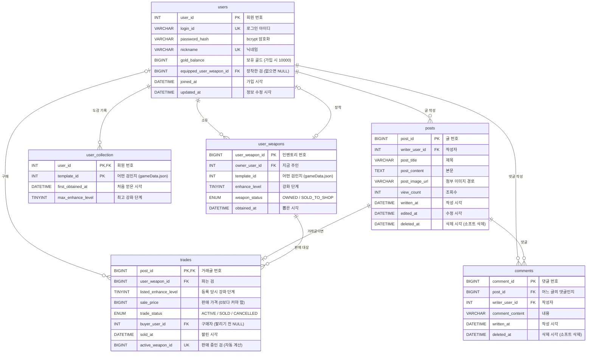

# 다섯 빛 공방

무기를 뽑고, 강화하고, 모으는 **수집형 힐링 게임**입니다. 경쟁이나 전투 없이, 뽑기로 얻은 검을 강화해 도감을 채우고, 상점에 팔거나 거래소에서 다른 유저와 거래합니다.

## 주요 기능

| 기능 | 설명 | 상태 |
|---|---|---|
| 회원가입·로그인 | 아이디, 닉네임, 비밀번호로 가입 (비밀번호는 bcrypt로 암호화해 저장) | 완료 |
| 랜덤 뽑기 | 골드 1,000을 내고 마도서를 뽑아 인벤토리·도감에 저장, 등급에 맞는 영상과 결과 명판 (지금은 예시 마도서 2개, 황금 확률 50%로 시연 중) | 진행 중 |
| 강화 | 장착한 마도서에 골드를 내고 룬을 새겨 +1~+3으로 강화. 성공 확률 90·80·60%, 비용 = 기본 가치 × 10·20·40%, 실패하면 골드만 쓰고 단계는 그대로, 강화할수록 가치가 오름 (공방 화면의 강화 탭) | 완료 |
| 도감 | 게임에 나오는 마도서를 선반으로 보여 줌. 얻은 마도서는 이름·설명·처음 얻은 날·최고 강화 단계, 아직 못 얻은 마도서는 잠긴 칸(이름 ???, 등급만) (공방 화면의 도감 탭) | 완료 |
| 상점 판매 | 내 마도서를 지금 가치(기본 가치 × 강화 배율)대로 팔아 골드를 얻음. 한 번 묻고 팔며, 장착 중인 마도서는 먼저 장착을 풀어야 함. 판 마도서는 인벤토리에서 빠지지만 도감 기록은 남음 (공방 화면의 상점 탭) | 완료 |
| 거래소 | 제목, 이미지, 설명, 가격을 올려 다른 유저에게 판매, 댓글 (게임 메뉴에서는 잠시 뺐고, 만들 때 다시 넣음) | 예정 |
| 커뮤니티 게시판 | 글 목록·읽기·쓰기, 내 글 고치기·지우기, 댓글 쓰기·내 댓글 지우기, 조회수 (읽기는 누구나, 쓰기는 로그인) | 완료 |

## DB 구조

MySQL 8.0, DB 이름 `weapon_game`, 테이블 6개 ([db/schema.sql](db/schema.sql))



### 테이블 설명

| 테이블 | 하는 일 |
|---|---|
| `users` | 회원 정보와 보유 골드, 지금 장착한 검 |
| `user_weapons` | 인벤토리. 지금 가진 검 한 자루마다 한 줄. 상점에 팔아도 기록은 남김 |
| `user_collection` | 도감. 한 번이라도 얻은 검과 최고 강화 단계 (거래하거나 팔아도 남음) |
| `posts` | 게시글. 자유글과 거래글을 같이 저장 |
| `comments` | 게시글의 댓글 |
| `trades` | 거래 내역. 거래글이면 `posts` 한 줄과 `trades` 한 줄이 짝을 이룸 |

### 설계 포인트

- **DB에는 유저 데이터만 저장합니다.** 무기 목록(이름, 등급, 가격, 이미지), 등급 확률, 강화 규칙은 서버의 `gameData.json`에 두고, DB에는 그 무기의 번호(`template_id`)만 저장합니다.
- **같은 검이 동시에 두 번 판매되지 않습니다.** `trades.active_weapon_id`는 판매 중(ACTIVE)일 때만 검 번호가 들어가는 자동 계산 칸이고, 여기에 UNIQUE를 걸어 중복 판매를 막습니다.
- **남의 검은 장착할 수 없습니다.** `users`의 (회원 번호, 장착한 검)이 인벤토리의 (주인, 검)과 일치해야 하는 FK(`fk_users_equipped`)가 있습니다.
- **골드는 음수가 될 수 없습니다.** `gold_balance`가 UNSIGNED라 잔액보다 많이 빼려 하면 에러가 납니다.
- **글과 댓글은 실제로 지우지 않습니다.** 삭제 시각(`deleted_at`)만 기록하는 소프트 삭제입니다.
- **뽑기, 강화, 장착, 상점 판매는 한 트랜잭션입니다.** 회원 행 → 마도서 행 순서로 잠그고(`SELECT … FOR UPDATE`) 골드, 인벤토리 상태·강화 단계, 도감 기록을 함께 저장합니다. 강화 버튼을 동시에 여러 번 눌러도 골드가 한 번 낼 만큼만 빠지고, 같은 마도서를 동시에 팔아도 한 번만 팔립니다.
- **상점에 판 마도서도 행은 남깁니다.** `weapon_status`를 `SOLD_TO_SHOP`으로 바꿀 뿐이라 기록이 남고, 도감(`user_collection`)도 그대로입니다.

## 실행 방법

1. MySQL에서 [db/schema.sql](db/schema.sql)을 실행해 DB를 만듭니다.
2. [server/.env.example](server/.env.example)을 복사해 `server/.env`를 만들고 MySQL 비밀번호를 적습니다.
3. 서버를 설치하고 실행합니다.
   ```
   cd server
   npm install
   npm start
   ```
4. 브라우저에서 http://localhost:3000 으로 접속합니다.

## 폴더 구조

```
db/schema.sql          DB 테이블 정의
server/                Node.js 서버 (Express, MySQL 연결, 회원·게시판·뽑기·도감·인벤토리(장착, 강화, 상점 판매) API)
server/uploads/        게시글에 붙인 이미지 (서버가 자동으로 만들고, git에 올리지 않음. DB에는 경로만 저장)
frontend/              화면 (타이틀, 게임, 게시판, 공방은 같은 밤 세계)
  index.html           타이틀 화면 (로그인한 뒤 "게임 시작" → 마도서 속으로 들어가 game.html)
  game.html            게임 첫 화면 (뽑기, 아래 메뉴에서 강화·도감·상점·커뮤니티로)
  board.html           커뮤니티 게시판 (글 목록, 읽기, 쓰기·고치기, 댓글)
  atelier.html         공방 (위쪽 탭: 도감 선반 | 강화 작업대와 내 마도서·장착 | 상점 팔기)
  video/               뽑기 영상 (일반판, 황금판)
  css/                 공통 색과 글꼴(tokens.css), 타이틀 글자·메뉴(title.css), 룬 각인·입장 타임라인(timeline.css), 게임 화면(game/),
                       별도 페이지 공통 바탕·판·버튼(page.css), 게시판(board.css), 공방(atelier.css)
  js/function/         타이틀 기능: 시작, 로그인, 메뉴 키보드, 입장, 카메라
  js/design/           타이틀 디자인: 산맥, 섬, 마도서, 룬 띠, 효과 (Three.js 3D)
  js/game/             게임 화면: function/(기능), design/(디자인)
  js/board/            게시판 화면: 화면 바꾸기와 글·댓글(main.js)
  js/atelier/          공방 화면: 탭, 도감 선반, 강화 작업대, 장착, 상점 팔기(main.js)
  js/shared/           여러 화면이 같이 쓰는 것: 타이틀·게임의 3D 디자인(밤하늘, 마력 가루, 마도서 그림, 셰이더, 텍스처, 재질),
                       게시판·공방의 서버 API 부르기(api.js)와 요소·숫자·시각·알림·확인 창 도구(page.js)
plan.md                기획서
LIBRARIES.md           사용하는 라이브러리 설명
```
