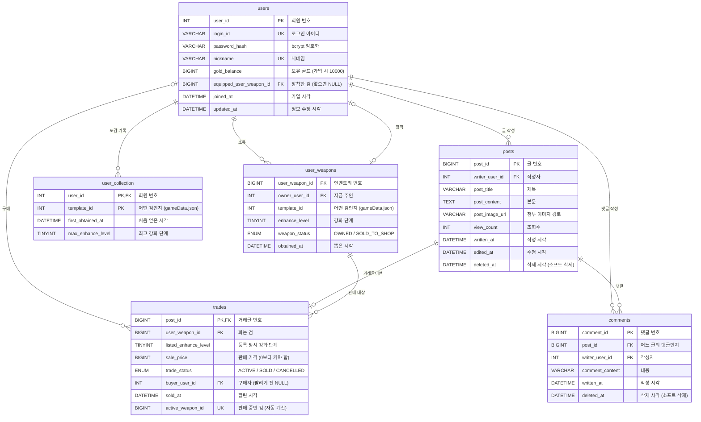

# 다섯 빛 공방

무기를 뽑고, 강화하고, 모으는 **수집형 힐링 게임**입니다. 경쟁이나 전투 없이, 뽑기로 얻은 검을 강화해 도감을 채우고, 상점에 팔거나 거래소에서 다른 유저와 거래합니다.

## 주요 기능

| 기능 | 설명 | 상태 |
|---|---|---|
| 회원가입·로그인 | 아이디, 닉네임, 비밀번호로 가입 (비밀번호는 bcrypt로 암호화해 저장) | 완료 |
| 랜덤 뽑기 | 골드를 써서 1~5등급 검을 뽑음 | 예정 |
| 강화 | 골드를 써서 장착한 검을 강화, 강화할수록 값이 오름 | 예정 |
| 도감 | 한 번이라도 얻은 검을 기록 | 예정 |
| 상점 판매 | 검을 정해진 값에 상점에 팔아 골드를 얻음 | 예정 |
| 거래소 | 제목, 이미지, 설명, 가격을 올려 다른 유저에게 판매, 댓글 | 예정 |

## DB 구조

MySQL 8.0, DB 이름 `weapon_game`, 테이블 6개 ([db/schema.sql](db/schema.sql))



### 테이블 설명

| 테이블 | 하는 일 |
|---|---|
| `users` | 회원 정보와 보유 골드, 지금 장착한 검 |
| `user_weapons` | 인벤토리. 지금 가진 검 한 자루마다 한 줄. 상점에 팔아도 기록은 남김 |
| `user_collection` | 도감. 한 번이라도 얻은 검과 최고 강화 단계 (거래하거나 팔아도 남음) |
| `posts` | 게시글. 자유글과 거래글을 같이 저장 |
| `comments` | 게시글의 댓글 |
| `trades` | 거래 내역. 거래글이면 `posts` 한 줄과 `trades` 한 줄이 짝을 이룸 |

### 설계 포인트

- **DB에는 유저 데이터만 저장합니다.** 무기 목록(이름, 등급, 가격, 이미지), 등급 확률, 강화 규칙은 서버의 `gameData.json`에 두고, DB에는 그 무기의 번호(`template_id`)만 저장합니다.
- **같은 검이 동시에 두 번 판매되지 않습니다.** `trades.active_weapon_id`는 판매 중(ACTIVE)일 때만 검 번호가 들어가는 자동 계산 칸이고, 여기에 UNIQUE를 걸어 중복 판매를 막습니다.
- **남의 검은 장착할 수 없습니다.** `users`의 (회원 번호, 장착한 검)이 인벤토리의 (주인, 검)과 일치해야 하는 FK(`fk_users_equipped`)가 있습니다.
- **골드는 음수가 될 수 없습니다.** `gold_balance`가 UNSIGNED라 잔액보다 많이 빼려 하면 에러가 납니다.
- **글과 댓글은 실제로 지우지 않습니다.** 삭제 시각(`deleted_at`)만 기록하는 소프트 삭제입니다.

## 실행 방법

1. MySQL에서 [db/schema.sql](db/schema.sql)을 실행해 DB를 만듭니다.
2. [server/.env.example](server/.env.example)을 복사해 `server/.env`를 만들고 MySQL 비밀번호를 적습니다.
3. 서버를 설치하고 실행합니다.
   ```
   cd server
   npm install
   npm start
   ```
4. 브라우저에서 http://localhost:3000 으로 접속합니다.

## 폴더 구조

```
db/schema.sql          DB 테이블 정의
server/                Node.js 서버 (Express, MySQL 연결, 회원 API)
frontend/              화면
  index.html
  css/                 글자·메뉴(title.css), 강화 타임라인(timeline.css)
  js/function/         기능: 시작, 로그인, 카메라
  js/design/           디자인: 하늘, 섬, 검, 효과 (Three.js 3D)
plan.md                기획서
LIBRARIES.md           사용하는 라이브러리 설명
```
